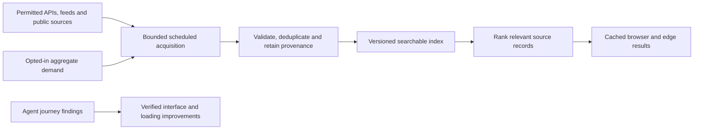

# Discovery and observed user journeys

The owner requested this work on 11 October 2026: test the platform with agents
acting as visitors, record their activity and friction, and use aggregated demand
to improve crawling, indexing, loading and intelligence. The current worktree
implements a bounded metadata index, optional aggregate-demand counter and
demand-guided GKG sampling, plus persistent World Bank annual snapshots. These
changes are **pending release, not verified live**. No general web crawler has
been implemented; acquisition uses the existing reviewed feeds and one fixed
scheduled GKG bulk batch. This document separates those implementations from the
remaining journey and deployment acceptance checks.

## Observe actual journeys

Use independent first-visit, mobile, research and returning/offline scenarios.
Run them against one immutable build. Each report must distinguish actual browser
actions, API requests, static inspection and unavailable capabilities. An agent
cannot report that it clicked a control when it only inspected its source.

| Journey | Task | Evidence |
| --- | --- | --- |
| First visit | Find Brussels, establish a 10 km workspace, inspect available layers and understand empty coverage | Action timestamps, current location/radius, rendered map, source status and any confusing control |
| Mobile | Search, change a layer, enlarge text, dismiss panels and navigate at 390 × 844 | Visible focus, readable labels and credits, no primary controls outside the viewport, screenshots |
| Research | Open a hazard, compare original sources and dates, record a private note and export it | Original URLs, explicit observation/publication/retrieval dates, no claim that related links verify a report |
| Returning/offline | Reload a saved view, retain preferences, lose/recover connectivity | Controls-ready and first-frame marks, cache delivery type, saved preferences, explicit offline/stale state |

Keep a bounded trace per run: scenario, build commit, synthetic input, action,
time, observed result, evidence path and severity. Avoid credentials, cookies,
real device location, private visitor notes or screenshots of private material.
Reports should identify the smallest repair that resolves observed friction.
Agent traces are test traffic; exclude them from all demand counts. Several
successful agent journeys are useful regression evidence, not proof of real
human usability or production capacity at 300 simultaneous visitors.

The existing first-visit and returning/mobile traces under `.qa/` contain actual
local HTTP requests, static inspection and synthetic contract checks. Their
browser surfaces were unavailable at that time, so those traces do not establish
real clicks, mobile layout or an offline reload. A later parent browser record
does establish one 390×844 Larger-text check and actual warm startup/framing
observations. Complete the remaining independent journeys against the final
immutable release rather than treating the earlier partial traces as full runs.

## Crawl → index → rank → serve

Google documents separate discovery/crawling, indexing and serving stages. This
platform follows that separation at its own scale through curated acquisition,
metadata indexing and serving; it has no general page crawler or Google-scale
coverage/ranking. [Google Search stages](https://developers.google.com/search/docs/fundamentals/how-search-works/)

1. **Acquire:** start with existing reviewed structured feeds and GDELT bulk
   metadata. A source registry records the fixed origin, rights, allowed paths,
   byte/record limits, cadence and failure policy. Page crawling requires separate
   permission and robots evaluation; follow robots rules, respect access failures,
   bound redirects to approved origins and avoid login/CAPTCHA bypasses. Use
   conditional requests and source release schedules. [Robots Exclusion Protocol](https://www.rfc-editor.org/rfc/rfc9309.html)
2. **Index:** preserve the original source record, canonical URL, source ID,
   content kind, topic/country mentions, dates, retrieval time, revision and rights.
   Use a versioned manifest and atomic last-good snapshot. Remove withdrawn or
   expired material. A mention, forecast, measurement and creator commentary
   remain different kinds. Metadata permission does not license an article body,
   photograph or transcript.
3. **Rank:** combine query relevance, explicit geographic match, observation
   freshness and source type. Explain why a record matched. Country mentions do
   not establish incident locations. Deduplicate syndicated URLs without counting
   them as independent confirmation. Popularity may prioritize acquisition and
   cache warming; it must not turn a popular allegation into a verified fact.
4. **Serve:** share the same bounded index across visitors, use versioned browser
   snapshots and query-result caches, and refresh in the background. Never crawl
   synchronously for each search. Report the index's coverage and last refresh;
   a zero-result sample must not be presented as proof that no event occurred.

The implemented [metadata index](DISCOVERY_SEARCH.md) canonicalizes URL/kind,
preserves source generations and dates, and retains at most 600 records/2 MiB
of serialized metadata; the API uses a tighter 440-record cap. Country-name
aliases and every reviewed GKG label are searchable. Exact known theme IDs are
translated to labels by the browser/API entry points. All query terms must match
metadata, with explicit match reasons and relevance/date/provenance/diversity
ordering. No ordering value establishes confidence, truth or popularity.

The browser keeps ordinary free-text searches local. The scheduled reader uses
one shared acquisition rather than a new upstream query for each search. Browser
and legacy API now share related-report grouping with query relevance preserved;
all original primary/related source dates and links survive. Compact topic labels
follow the selected category. Source expiry and individual GKG batch expiry apply
to searches and default groups, including failed-refresh and clear-query paths.
The source/parity regressions are implemented; deployment must verify their
presence in the published artifact.

The [annual economic facts](ECONOMIC_FACTS.md) Worker path can lazily reuse strict
`EARTH_STORE` snapshots across instances, at most 50 observations/64 KiB per
supported economy. Restoration preserves the original retrieval date and the
24-hour freshness/seven-day stale bounds. This persistence change is also pending
release; it introduces no startup dataset sweep or observation interpolation.

## Aggregate demand without private search histories

The implemented [counter](AGGREGATE_DEMAND.md) starts unchecked on each page and
records only an explicitly consented, accepted form-submit action matching a
reviewed subject or category/country overview. The outgoing payload is exactly
`{subjectId, country, consent:true}`. Arbitrary raw queries, publisher searches,
precise coordinates, identity, device fingerprints and notebook contents are
excluded. Matching a known label does not create consent. Mounted panels,
refreshes, polling and map movement do not increment the counter.

The public summary reports only groups with at least **300 accepted actions**
over seven UTC calendar days, rounded down to 100-action buckets. These are
consented search actions, not unique people or proof of representative interest.
The 300-action threshold and 300 reviewed YouTube comments do not establish
capacity for 300 concurrent visitors. Preview/local/marked agent traffic is
excluded; tests used synthetic summaries and storage, with no real demand POSTs
or manufactured production counts. Physical idle-period deletion still requires
the scoped lifecycle/scheduler configuration described in the counter document.

The scheduled [sampling integration](INTELLIGENCE_PRIORITY.md) reads one fixed
owned public summary and uses only its validated, rounded reviewed subjects.
It preserves at least 60 of 80 balanced records per category and lets at most 20
slots favor demanded metadata, within the existing 10,000-candidate budget and
publisher/country/theme limits. Unavailable or unmatched demand preserves the
balanced baseline. Source URLs, dates and verification cautions stay unchanged.
The official archive count and acquisition cadence remain fixed. General page
crawling, demand-built topic landing pages and arbitrary cache warming remain
future work. The counter and sampling integration require the pending release
and actual hosted checks before being described as live.

New source acquisition still requires rights and coverage checks even when demand
is high. Publish the source catalogue, freshness limits, ranking explanation and
journey findings so platform improvements can be examined by others.
