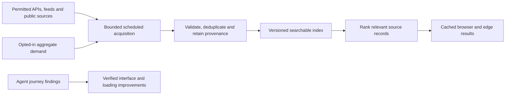

# Discovery and observed user journeys

The owner requested this work on 11 October 2026: test the platform with agents
acting as visitors, record their activity and friction, and use aggregated demand
to improve crawling, indexing, loading and intelligence. This document defines
the next acceptance slice. It does not claim that a visitor analytics system or
a general web crawler is already deployed.

## Observe actual journeys

Use independent first-visit, mobile, research and returning/offline scenarios.
Run them against one immutable build. Each report must distinguish actual browser
actions, API requests, static inspection and unavailable capabilities. An agent
cannot report that it clicked a control when it only inspected its source.

| Journey | Task | Evidence |
| --- | --- | --- |
| First visit | Find Brussels, establish a 10 km workspace, inspect available layers and understand empty coverage | Action timestamps, current location/radius, rendered map, source status and any confusing control |
| Mobile | Search, change a layer, enlarge text, dismiss panels and navigate at 390 × 844 | Visible focus, readable labels and credits, no primary controls outside the viewport, screenshots |
| Research | Open a hazard, compare original sources and dates, record a private note and export it | Original URLs, explicit observation/publication/retrieval dates, no claim that related links verify a report |
| Returning/offline | Reload a saved view, retain preferences, lose/recover connectivity | Controls-ready and first-frame marks, cache delivery type, saved preferences, explicit offline/stale state |

Keep a bounded trace per run: scenario, build commit, synthetic input, action,
time, observed result, evidence path and severity. Avoid credentials, cookies,
real device location, private visitor notes or screenshots of private material.
Reports should identify the smallest repair that resolves observed friction.
Agent traces are test traffic; exclude them from all demand counts. Several
successful agent journeys are useful regression evidence, not proof of real
human usability or production capacity at 300 simultaneous visitors.

## Crawl → index → rank → serve

Google documents separate discovery/crawling, indexing and serving stages. This
platform should use the same separation at its own scale, with a curated source
catalogue and dated evidence. It should not claim Google's coverage or ranking
quality. [Google Search stages](https://developers.google.com/search/docs/fundamentals/how-search-works/)

1. **Acquire:** start with existing reviewed structured feeds and GDELT bulk
   metadata. A source registry records the fixed origin, rights, allowed paths,
   byte/record limits, cadence and failure policy. Page crawling requires separate
   permission and robots evaluation; follow robots rules, respect access failures,
   bound redirects to approved origins and avoid login/CAPTCHA bypasses. Use
   conditional requests and source release schedules. [Robots Exclusion Protocol](https://www.rfc-editor.org/rfc/rfc9309.html)
2. **Index:** preserve the original source record, canonical URL, source ID,
   content kind, topic/country mentions, dates, retrieval time, revision and rights.
   Use a versioned manifest and atomic last-good snapshot. Remove withdrawn or
   expired material. A mention, forecast, measurement and creator commentary
   remain different kinds. Metadata permission does not license an article body,
   photograph or transcript.
3. **Rank:** combine query relevance, explicit geographic match, observation
   freshness and source type. Explain why a record matched. Country mentions do
   not establish incident locations. Deduplicate syndicated URLs without counting
   them as independent confirmation. Popularity may prioritize acquisition and
   cache warming; it must not turn a popular allegation into a verified fact.
4. **Serve:** share the same bounded index across visitors, use versioned browser
   snapshots and query-result caches, and refresh in the background. Never crawl
   synchronously for each search. Report the index's coverage and last refresh;
   a zero-result sample must not be presented as proof that no event occurred.

## Aggregate demand without private search histories

For example, 300 search actions about a permitted topic can raise its refresh
priority, build a useful topic landing page and warm its results. That is a
count of searches; it is not a claim of 300 distinct people.

The first collection slice should be explicit opt-in and count reviewed topic
IDs plus coarse country filters only. Keep queries local by default; do not retain
raw arbitrary searches, precise coordinates, identity, device fingerprints or
private notebook contents. Hashing a raw query does not remove its sensitivity.
Use bounded daily aggregates, a minimum reporting threshold, retention expiry,
rate limits and a public explanation of the collected fields. Bot/agent runs are
excluded. Test demand scheduling with synthetic fixtures rather than publishing
fake popularity or changing real visitor counts.

New source acquisition still requires rights and coverage checks even when demand
is high. Publish the source catalogue, freshness limits, ranking explanation and
journey findings so platform improvements can be examined by others.
